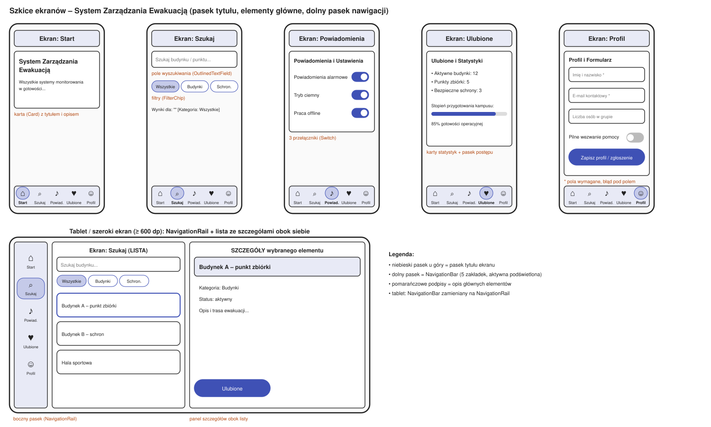
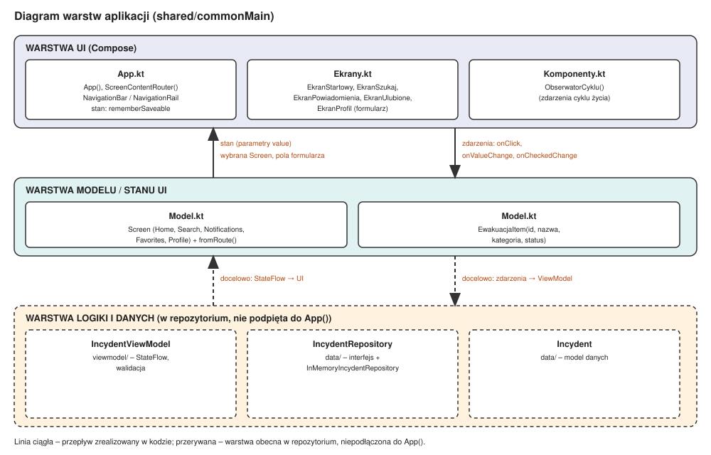

This is a Kotlin Multiplatform project targeting Android and iOS.

* [/iosApp](./iosApp/iosApp) contains an iOS application. Even if you’re sharing your UI with Compose Multiplatform, you need this entry point for your iOS app.
* [/shared](./shared/src) contains code shared across Compose Multiplatform applications (`commonMain`, `androidMain`, `iosMain`).

---

## Etap 1 - Interfejs użytkownika i nawigacja

W ramach pierwszego etapu projektu zaimplementowano podstawę aplikacji mobilnej:
1. **Start projektu i temat**: Uruchomienie projektu Kotlin Multiplatform z Compose Multiplatform, opierającego się na systemie zarządzania bezpieczeństwem i ewakuacją.
2. **Motyw i biblioteka komponentów**: Wykorzystanie nowoczesnego systemu stylów Material 3 (`MaterialTheme`).
3. **Pięć ekranów**: Stworzenie dedykowanych widoków: Start, Szukaj, Powiadomienia, Ulubione oraz Profil.
4. **Dolna nawigacja**: Implementacja paska nawigacji (`NavigationBar` i `NavigationBarItem`) do przełączania między ekranami.
5. **Układ responsywny**: Wykorzystanie `BoxWithConstraints` w celu dynamicznej zmiany nawigacji na boczny pasek (`NavigationRail`) na szerszych ekranach (tablety, komputery / macOS).

### Uzupełnienie etapu 1 – szkice, formularz, statystyki i ustawienia

6. **Szkice ekranów i dolnego paska nawigacji** (katalog [`docs/`](./docs)): szkic wszystkich pięciu ekranów (Start, Szukaj, Powiadomienia, Ulubione, Profil) z zaznaczonym paskiem tytułu, głównymi elementami i dolnym paskiem nawigacji (`NavigationBar`). Na szkicu ekranu Szukaj zaznaczono pole wyszukiwania i filtry (`FilterChip`). Dodano także szkic tabletu: boczny `NavigationRail` oraz lista i panel szczegółów obok siebie.

   

   *Rys. 1. Szkice pięciu ekranów, dolnego paska nawigacji i widoku tabletu (lista + szczegóły).*

7. **Formularz z walidacją** (ekran Profil, `EkranProfil` w `Ekrany.kt`):
   - pola tekstowe: *Imię i nazwisko \** oraz *E-mail kontaktowy \** (klawiatura e-mail),
   - pole liczbowe: *Liczba osób w grupie* (klawiatura numeryczna),
   - lista rozwijana (`DropdownMenu`): *Typ zgłoszenia* (pożarowe, chemiczne, awaria zasilania, inne),
   - przełącznik (`Switch`): *Pilne wezwanie pomocy*,
   - pola wymagane oznaczone gwiazdką; po próbie zapisu z pustym polem pod nim pojawia się komunikat „Pole wymagane!” (`isError` + tekst błędu w kolorze `error`), a błąd znika po rozpoczęciu poprawiania pola,
   - po poprawnym zapisie wyświetlany jest komunikat „Zgłoszenie wysłane pomyślnie!”,
   - treść ekranu jest przewijalna (`verticalScroll`), dzięki czemu pola nie giną pod klawiaturą,
   - stan formularza jest zachowywany przez `rememberSaveable`.

8. **Ekran statystyk i ekran ustawień**:
   - **Statystyki** (zakładka *Ulubione*, `EkranUlubione`): trzy wartości wyliczane z listy `przykladoweElementy` (`Model.kt`): liczba wszystkich elementów, liczba w poszczególnych kategoriach (budynki, punkty zbiórki, schrony) wyświetlane na kartach oraz pasek postępu (`LinearProgressIndicator`) z odsetkiem elementów o statusie „Gotowy”.
   - **Ustawienia** (zakładka *Powiadomienia*, `EkranPowiadomienia`): trzy przełączniki (`Switch`): *Powiadomienia alarmowe*, *Tryb ciemny*, *Praca offline*; ich stan jest zachowywany przy obrocie ekranu.

---

## Etap 2 - Cykl życia aplikacji i zachowanie stanu

W ramach drugiego etapu projektu (zgodnie z wymaganiami Laboratorium 3) zaimplementowano:
1. **Obserwację zdarzeń cyklu życia (`LifecycleEventEffect`)**:
   - W kodzie wspólnym (`commonMain`) dodano komponent `ObserwatorCyklu`, który monitoruje zdarzenia `ON_START`, `ON_RESUME`, `ON_PAUSE` oraz `ON_STOP` niezależnie na platformie Android oraz iOS za pomocą biblioteki `lifecycle-runtime-compose`.
2. **Zachowanie stanu ekranów (`rememberSaveable`)**:
   - Zachowywanie wybranej zakładki dolnej/bocznej nawigacji (`selectedRoute`).
   - Zachowywanie wpisanej frazy w wyszukiwarce (`searchQuery`).
   - Zachowywanie danych formularza profilu (`profileName`, `profileEmail`).
   - Zachowywanie stanu przełącznika powiadomień (`notificationsEnabled`).
   - Stan ten nie ulega utracie podczas obrotu urządzenia (zmiana konfiguracji) ani przy wstrzymaniu aplikacji.

### Uzupełnienie etapu 2 – logi cyklu życia, `ObserwatorCyklu`, zabicie procesu

3. **Logi w `MainActivity`** (przykład 3.1): w każdej metodzie cyklu życia (`onCreate`, `onStart`, `onResume`, `onPause`, `onStop`, `onRestart`, `onDestroy`) dodano wpis `Log.d("CYKL", ...)`; `onCreate` loguje, czy odtworzono zapisany stan, a `onDestroy` – wartości `isFinishing` i `isChangingConfigurations`. Filtr w Logcat: `tag:CYKL`.

   | Test | Zaobserwowana kolejność wpisów | Wnioski |
   |---|---|---|
   | Uruchomienie aplikacji | `onCreate` (stan zapisany: false) → `onStart` → `onResume` | Aktywność przechodzi do stanu widocznego i aktywnego (interaktywnego). |
   | Przycisk Home i powrót z ikony | `onPause` → `onStop`; po powrocie `onRestart` → `onStart` → `onResume` | Aktywność jest tylko zatrzymana, a nie zniszczona – bez `onCreate`, stan w pamięci pozostaje. |
   | Przycisk Wstecz (zamknięcie) | `onPause` → `onStop` → `onDestroy` (isFinishing=true) | Zamknięcie przez użytkownika niszczy aktywność. |
   | Obrót ekranu | `onPause` → `onStop` → `onDestroy` (isChangingConfigurations=true) → `onCreate` (stan zapisany: true) → `onStart` → `onResume` | Zmiana konfiguracji odtwarza aktywność; stan trzeba zachować (`rememberSaveable`). |
   | (a) Lista ostatnich aplikacji (Overview) i powrót | `onPause` → `onStop`; po powrocie `onRestart` → `onStart` → `onResume` | Aplikacja przestaje być widoczna, ale proces i aktywność nadal żyją. |
   | (b) Symulowane połączenie / powiadomienie (Extended controls → Phone) | Połączenie na pełnym ekranie: `onPause` → `onStop`; po zakończeniu `onRestart` → `onStart` → `onResume`. Zwykłe powiadomienie typu heads-up: bez wpisów | Pełnoekranowy ekran połączenia zasłania aplikację i zatrzymuje ją; powiadomienie, które jej nie zasłania, nie zmienia stanu cyklu życia. |
   | (c) Włączenie/wyłączenie trybu ciemnego w systemie | `onPause` → `onStop` → `onDestroy` (isChangingConfigurations=true) → `onCreate` (stan zapisany: true) → `onStart` → `onResume` | Zmiana motywu systemu to zmiana konfiguracji (`uiMode`) – aktywność jest odtwarzana jak przy obrocie. |

   Zrzut okna Logcat z jednego testu należy umieścić w katalogu `docs/` (np. `docs/logcat-obrot.png`).

4. **`ObserwatorCyklu`** (przykład 3.2, plik `Komponenty.kt`): funkcja `@Composable ObserwatorCyklu(nazwa)` loguje (`println("CYKL [nazwa]: ...")`) dodanie i usunięcie kompozycji (`DisposableEffect`) oraz zdarzenia `ON_START`, `ON_RESUME`, `ON_PAUSE`, `ON_STOP` (`LifecycleEventEffect`). Użyto jej z różnymi nazwami w ekranach: `Ekran_Start`, `Ekran_Szukaj`, `Ekran_Powiadomienia`, `Ekran_Ulubione`, `Ekran_Profil` oraz w korzeniu aplikacji (`AppRoot`).

   **Wnioski z obserwacji:**
   1. Przejście między zakładkami usuwa kompozycję dotychczasowego ekranu („kompozycja usunięta”) i dodaje kompozycję nowego („kompozycja dodana”) – w danej chwili istnieje tylko wybrany ekran; zdarzenia cyklu życia przy tym nie występują.
   2. Obrót ekranu odtwarza aktywność, więc usuwane i dodawane są kompozycje wszystkich ekranów łącznie z `AppRoot`, a zdarzenia `ON_PAUSE`/`ON_STOP` i potem `ON_START`/`ON_RESUME` pojawiają się dla każdego obserwatora.

   **Dlaczego `ON_START` i `ON_STOP` są wspólne dla wszystkich ekranów, a „kompozycja dodana” nie?** Zdarzenia `ON_START`/`ON_STOP` pochodzą z cyklu życia aktywności (`LifecycleOwner`), który jest jeden dla całej aplikacji – wszystkie obserwatory nasłuchują tego samego źródła, więc dostają zdarzenie jednocześnie. Dodanie i usunięcie kompozycji zależy natomiast od drzewa interfejsu: każdy ekran wchodzi do kompozycji i z niej wychodzi niezależnie, gdy `when` wybierze inną zakładkę.

5. **Test zabicia procesu** – metoda „Don't keep activities” (Opcje programisty) oraz `adb shell am kill pl.uczelnia.projekt` po wyjściu z aplikacji przyciskiem Home. Stan zachowują wartości w `rememberSaveable`, zapisywane do `Bundle`:

   | Ekran | Stan wprowadzony przed testem | Stan po powrocie | Uwagi |
   |---|---|---|---|
   | Start | brak pól do wprowadzania; wybrana zakładka Start | Zakładka Start wybrana, treść bez zmian | Wybór zakładki (`selectedRoute`) jest w `rememberSaveable`. |
   | Szukaj | fraza w polu wyszukiwania, wybrany filtr (np. Budynki) | Fraza i filtr zachowane | `searchQuery` i `filterCategory` w `rememberSaveable`. |
   | Powiadomienia | zmienione przełączniki ustawień | Stan trzech przełączników zachowany | Wartości `settingNotifications`, `settingDarkMode`, `settingOfflineMode`. |
   | Ulubione | brak pól do wprowadzania; wybrana zakładka Ulubione | Zakładka wybrana, statystyki widoczne | Ekran nie przechowuje własnego stanu. |
   | Profil | wypełnione pola formularza, przełącznik „Pilne” | Pola, przełącznik i komunikat o wysłaniu zachowane | `formName`, `formEmail`, `formCount`, `formIsUrgent`, `formSubmitted`, `formError`. |

---

## Etap 3 - Architektura warstwowa, nawigacja i CRUD

> Uwaga: warstwa ViewModel / repozytorium / ekrany CRUD (`viewmodel/`, `data/`, `ui/IncydentScreens.kt`) jest w repozytorium, ale aktualny `App()` używa pięciu ekranów z `Ekrany.kt` i nie jest z nią połączony.

1. **Podział na warstwy** (`shared/src/commonMain/.../projekt`):
   - **UI** – `App.kt`, `ui/IncydentScreens.kt` (lista, formularz; Compose, bez logiki biznesowej),
   - **ViewModel** – `viewmodel/IncydentViewModel.kt` (logika prezentacji, walidacja, stan jako `StateFlow`),
   - **Repozytorium / dane** – `data/IncydentRepository.kt` (interfejs + `InMemoryIncydentRepository`), model `data/Incydent.kt`.
2. **Nawigacja**: dolny pasek / boczny `NavigationRail` między 5 zakładkami oraz ekran formularza (dodawanie/edycja) ze strzałką wstecz w nagłówku; stan nawigacji zachowywany przy obrocie.
3. **CRUD** na liście zgłoszeń (zakładka Start): dodawanie (przycisk ＋), edycja, usuwanie z potwierdzeniem, oznaczanie jako ulubione (lista w zakładce Ulubione), wyszukiwanie w zakładce Szukaj.

4. **Diagram warstw aplikacji** (katalog [`docs/`](./docs)): nazwy klas każdej warstwy (UI – `App`, `ScreenContentRouter`, ekrany z `Ekrany.kt`, `ObserwatorCyklu`; model/stan – `Screen`, `EwakuacjaItem`; logika i dane – `IncydentViewModel`, `IncydentRepository`, `Incydent`) oraz strzałki kierunku przepływu: stan płynie w górę do interfejsu, zdarzenia użytkownika – w dół.

   

   *Rys. 2. Diagram warstw aplikacji: stan przepływa od warstwy danych i modelu do UI, a zdarzenia (kliknięcia, zmiany pól) od UI do warstwy niżej. Linia przerywana oznacza warstwę logiki i danych obecną w repozytorium, ale niepodłączoną obecnie do `App()`.*

---

## Zmiany poza etapami - warstwa wizualna (bez zmian w działaniu)

1. **Własny motyw** (`ui/theme/Theme.kt`): stonowany granat z pomarańczowym akcentem, wersja jasna i ciemna, własne zaokrąglenia (`Shapes`) i typografia (`Typography`).
2. **Przełącznik trybu ciemnego** w ustawieniach (zakładka Powiadomienia) steruje motywem `ProjektTheme`; domyślnie zgodny z ustawieniem systemu, wybór zachowywany przy obrocie ekranu (`rememberSaveable`). Tło motywu obejmuje cały ekran (także w poziomie), a kolor ikon pasków systemowych dopasowuje `PaskiSystemowe`.
3. **Ikony Material zamiast emoji** (zależność `material-icons-core`) w nawigacji, na kartach i w formularzu.
4. **Karta zgłoszenia**: pogrubiony tytuł, plakietka priorytetu (czerwona / żółta / zielona), lokalizacja z ikoną pinezki, opis do 2 linii, akcje (ulubione, edycja, usuwanie) jako ikony.
5. **Nagłówki ekranów** (`TopAppBar`), zakładka „Start” przemianowana na „Zgłoszenia”; formularz z nagłówkiem i strzałką wstecz, przyciski Zapisz/Anuluj na całą szerokość; chipy priorytetu w kolorach plakietek.
6. **Stany puste** (ikona + tekst) oraz ekrany Alerty i Profil ułożone w karty.
7. **Obsługa klawiatury w formularzu** (`imePadding`, przewijana treść, akcje IME Next/Done, chowanie klawiatury po dotknięciu tła), chipy priorytetu w układzie zawijanym (`FlowRow`), w poziomie przycisk „+” obok listy zamiast nad kartami, ciemne warianty plakietek priorytetu, jednoliniowe pola profilu i czytelne podsumowanie przy pustych danych; w wyszukiwarce i na Profilu klawiaturę chowa klawisz Search/Done oraz dotknięcie tła (naprawa błędu na iOS, gdzie klawiatura zasłaniała dolną nawigację).
8. Logika, ViewModel, repozytorium i nawigacja pozostały bez zmian.

---

### Uruchamianie aplikacji

- Android app: `./gradlew :androidApp:assembleDebug`
- iOS app: Otwórz katalog [/iosApp](./iosApp) w programie Xcode i uruchom stamtąd.

### Uruchamianie testów

- Android tests: `./gradlew :shared:testAndroidHostTest`
- iOS tests: `./gradlew :shared:iosSimulatorArm64Test`
